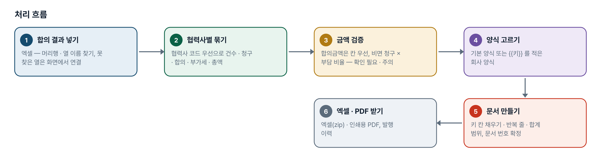
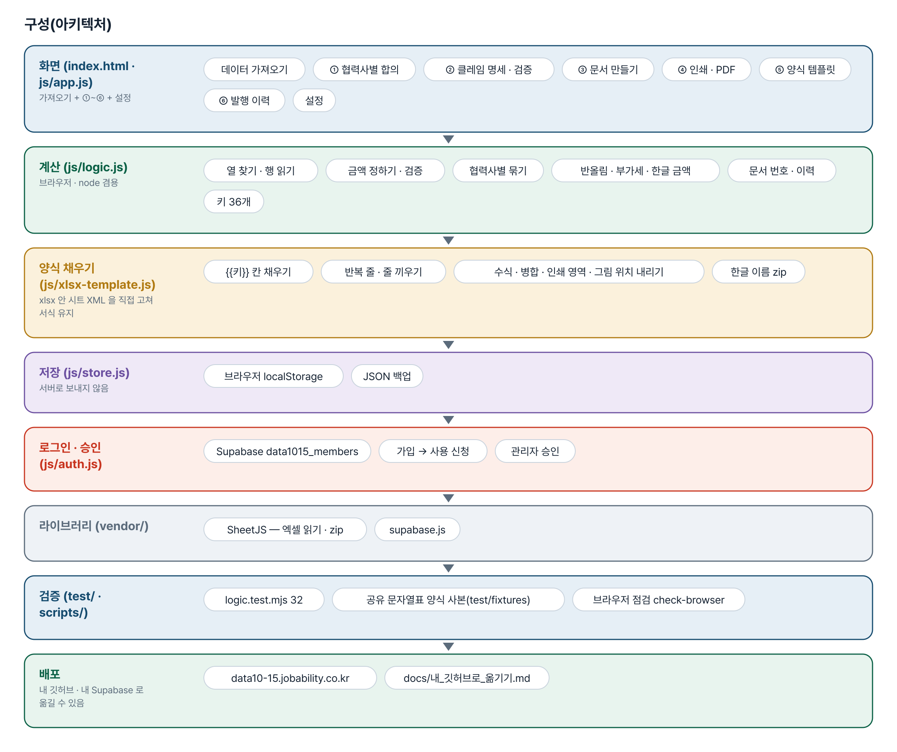
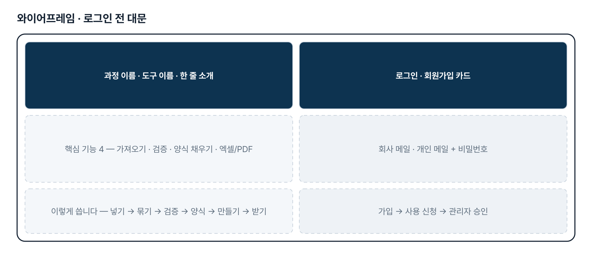
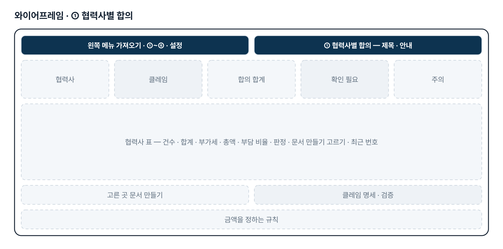
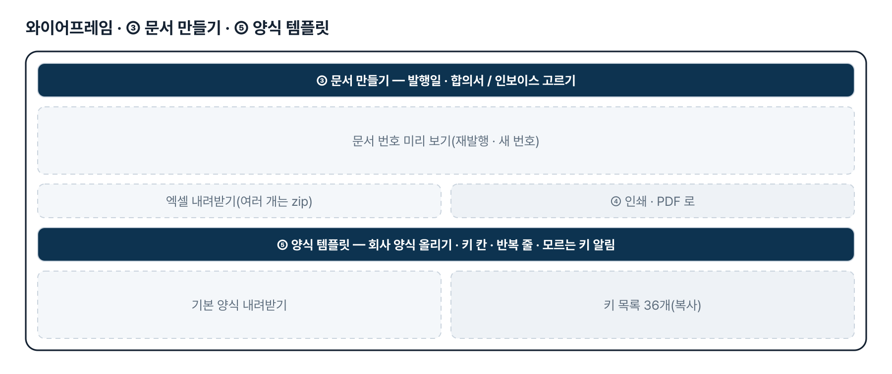
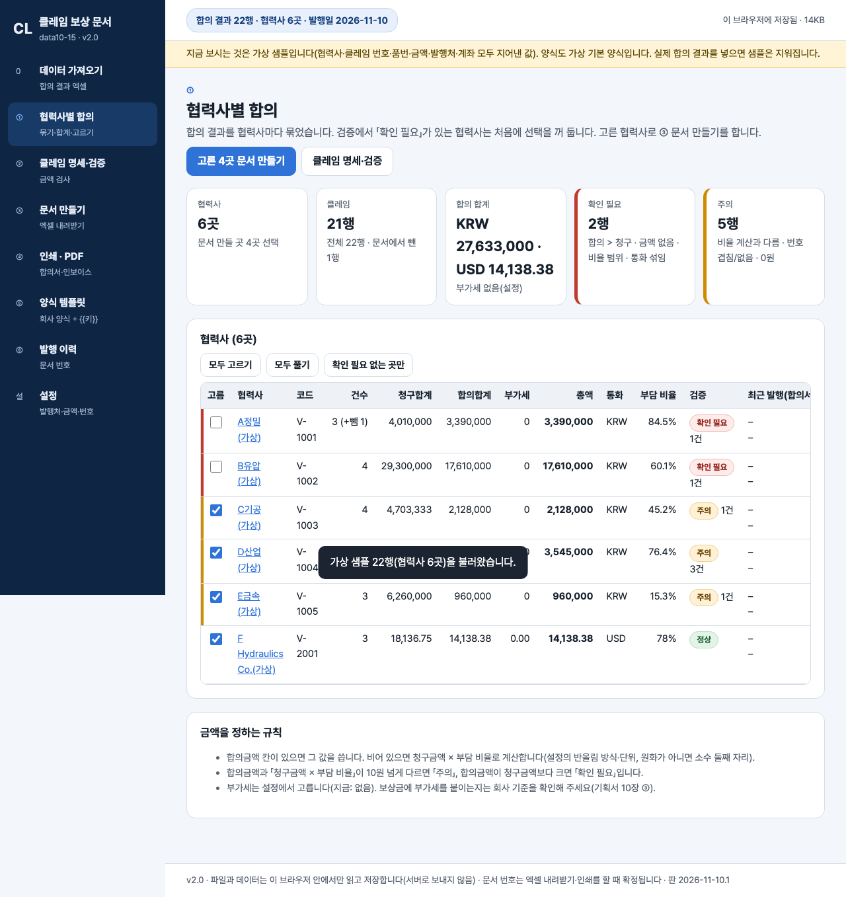

# 합의서 · 인보이스 자동 작성 — 프로젝트 기획서 v2.0

- 기획: 안민준 · 작성일 2026-11-10 · 현장 데이터 디지털화 전문가과정 · 2차수 프로젝트 15
- 바로 쓰기: https://data10-15.jobability.co.kr/
- 워드 판: `docs/기획서/data10-15_안민준_합의서인보이스자동작성_기획서_v2.0.docx`

## 개요

협력사와 보상 합의를 마친 결과 엑셀을 올리면 협력사별로 묶어 금액을 검증하고, 회사 합의서 · 인보이스 엑셀 양식의 {{키}} 칸을 채워 서식 그대로의 엑셀과 인쇄용 PDF 를 만드는 도구입니다.

### 배경 · 현재 업무
- 협력사와 클레임 보상 합의가 끝나면 합의 결과로 합의서와 인보이스를 각각 작성해야 합니다.
- 합의 결과 엑셀의 협력사 정보 · 클레임별 합의금액을 지정 양식에 손으로 옮겨 적어 시간이 들고 입력 오류가 생깁니다.
- 보유 데이터는 협력사별 합의 결과 엑셀, 기존 합의서 · 인보이스 엑셀 양식과 작성 완료 샘플입니다.

### 목표
- 합의 결과 엑셀을 올리면 협력사 · 클레임별 합의금액을 자동으로 읽습니다.
- 합의금액 · 비율 · 번호를 검증해 잘못된 줄을 문서를 만들기 전에 알립니다.
- 회사가 쓰던 엑셀 양식의 서식을 그대로 두고 값만 채워 합의서 · 인보이스를 만듭니다.
- 엑셀과 PDF 로 내려받고 문서 번호와 발행 이력을 남깁니다.

## 요구사항과 구현

| 기획서 요구 | 구현 |
|---|---|
| 합의 Excel 업로드 → 협력사 정보 · 클레임별 합의금액 자동 추출 | 머리행 자동 인식 · 열 이름 별칭 · 열 연결 화면 · 합계 줄 건너뛰기, 협력사(코드 우선)별 묶기 |
| 기존 지정 양식에 맞춰 문서 자동 작성 | 양식에 {{키}} 를 적어 올리면 서식(글꼴 · 테두리 · 병합 · 직인 그림) 그대로 값만 채움, 반복 줄 · 합계 범위 늘리기 |
| 합의서 · 인보이스 각각 Excel 다운로드 | 한 개 또는 zip 한 파일(한글 이름), 문서 번호 자동 채번 · 발행 이력 |
| 합의서 · 인보이스 PDF 다운로드 | 인쇄용 기본 양식 → 브라우저 「PDF로 저장」. 회사 양식 그대로의 PDF 자동 변환은 2단계 |
| 수작업 입력 오류 최소화 | 합의 > 청구 · 금액 없음 · 비율 범위 · 통화 섞임(확인 필요), 비율 계산과 다름 · 번호 겹침(주의), 한글 금액 · 합계 자동 |
| 결재 · 메일 발송 · 팀 공유 | 2단계 — 지금은 브라우저 저장 + JSON 백업 |

## 주요 기능

- **합의 결과 가져오기** — 엑셀 여러 개를 읽고 열 이름이 달라도 찾아 연결합니다. 협력사별로 건수 · 합의합계 · 부가세 · 총액을 묶습니다.
- **금액 검증** — 합의금액이 청구보다 크거나 비율 계산과 다른 줄을 「확인 필요 · 주의」로 알리고 그 협력사는 문서 만들기에서 뺍니다.
- **양식 그대로 채우기** — 회사 엑셀 양식의 {{키}} 칸만 채워 서식 · 병합 · 직인 그림을 그대로 둡니다. 표 줄이 모자라면 끼웁니다.
- **엑셀 · PDF 내려받기** — 합의서 · 인보이스를 엑셀(여러 개는 zip 한 파일)과 인쇄용 PDF 로 받습니다.
- **문서 번호 · 발행 이력** — 종류 · 달마다 일련번호, 같은 내용은 재발행(같은 번호), 바뀌면 새 번호와 「대체됨」.
- **설정 · 백업** — 발행처 · 입금 계좌 · 통화 · 부가세 · 반올림 · 허용 차이 · 번호 형식 · 합의 조건 문구, JSON 백업.
- **로그인 · 승인** — 회사 메일 또는 개인 메일로 가입하고 사용 신청 → 관리자 승인 뒤에 씁니다.

## 처리 흐름(파이프라인)

1. **합의 결과 넣기** — 엑셀 — 머리행 · 열 이름 찾기, 못 찾은 열은 화면에서 연결
2. **협력사별 묶기** — 협력사 코드 우선으로 건수 · 청구 · 합의 · 부가세 · 총액
3. **금액 검증** — 합의금액은 칸 우선, 비면 청구 × 부담 비율 — 확인 필요 · 주의
4. **양식 고르기** — 기본 양식 또는 {{키}} 를 적은 회사 양식
5. **문서 만들기** — 키 칸 채우기 · 반복 줄 · 합계 범위, 문서 번호 확정
6. **엑셀 · PDF 받기** — 엑셀(zip) · 인쇄용 PDF, 발행 이력

## 구성(아키텍처)

- **화면 (index.html · js/app.js)** — 데이터 가져오기 · ① 협력사별 합의 · ② 클레임 명세 · 검증 · ③ 문서 만들기 · ④ 인쇄 · PDF · ⑤ 양식 템플릿 · ⑥ 발행 이력 · 설정
- **계산 (js/logic.js)** — 열 찾기 · 행 읽기 · 금액 정하기 · 검증 · 협력사별 묶기 · 반올림 · 부가세 · 한글 금액 · 문서 번호 · 이력 · 키 36개
- **양식 채우기 (js/xlsx-template.js)** — {{키}} 칸 채우기 · 반복 줄 · 줄 끼우기 · 수식 · 병합 · 인쇄 영역 · 그림 위치 내리기 · 한글 이름 zip
- **저장 (js/store.js)** — 브라우저 localStorage · JSON 백업
- **로그인 · 승인 (js/auth.js)** — Supabase data1015_members · 가입 → 사용 신청 · 관리자 승인
- **라이브러리 (vendor/)** — SheetJS — 엑셀 읽기 · zip · supabase.js
- **검증 (test/ · scripts/)** — logic.test.mjs 32 · 공유 문자열표 양식 사본(test/fixtures) · 브라우저 점검 check-browser
- **배포** — data10-15.jobability.co.kr · docs/내_깃허브로_옮기기.md

## 화면 구성(와이어프레임)

## 규칙 · 판정 기준

- 합의금액은 엑셀 칸 값을 먼저 씁니다. 비어 있을 때만 청구금액 × 부담 비율로 계산하고 「참고」로 표시합니다.
- 확인 필요: 합의금액 > 청구금액 · 금액 없음 · 비율 범위 밖 · 한 협력사에 통화 섞임. 이런 협력사는 처음에 문서 만들기 선택을 꺼 둡니다.
- 주의: 칸 값과 비율 계산 값이 허용 차이(기본 10원)를 넘게 다름 · 클레임 번호 겹침/없음 · 0원.
- 키 하나만 적힌 칸은 숫자로 넣어 양식의 숫자 형식을 그대로 씁니다. 달러는 그 칸의 표시 형식만 소수 둘째 자리로 바꾼 새 스타일을 붙입니다.
- 표 줄은 빈 줄을 먼저 채우고 모자라면 끼우며, 끝이 표 마지막 줄에 닿은 SUM 범위는 늘립니다.
- 문서 번호는 내려받기 · 인쇄 때 확정합니다. 같은 내용은 같은 번호(재발행), 바뀌면 새 번호와 이전 번호 「대체됨」, 취소한 번호는 다시 쓰지 않습니다.

## 검증

- 계산 규칙 테스트 32개 통과
- node test/logic.test.mjs 32개 — 2026-11-10 통과(글자 · 숫자 · 날짜, 열 찾기, 검증, 묶기 · 금액, 번호 · 이력, 키, 양식 채우기, 저장).
- 양식 채우기는 공유 문자열표를 쓰는 양식 사본(test/fixtures)으로도 검사하고, 채우기 전후 스타일 번호가 같은지 봅니다.
- 브라우저 점검(선택, playwright-core): scripts/check-browser.mjs — 샘플 · zip 내려받기 · 재발행 · 인쇄 · 회사 양식 올리기 · 가로 넘침 · 콘솔 오류.

## 이번 판에서 하지 않는 것

- 업무 자료(합의 결과 · 양식 · 발행 이력)는 아직 팀 공유 DB 가 아니라 이 브라우저에 저장됩니다(다른 PC 로는 JSON 백업).
- 회사 양식 그대로의 PDF 자동 변환은 하지 않습니다 — 인쇄용 기본 양식을 PDF 로 저장하거나 받은 엑셀에서 저장합니다.
- 결재 · 메일 발송은 하지 않습니다.
- 도형 · 글상자 안의 키, 한 시트에 반복 표 두 개, .xls · 문서보안(DRM) 양식은 다루지 않습니다.
- 실제 합의 결과 · 회사 양식은 아직 받지 않아 샘플은 가상 협력사 6곳 · 22행입니다.

## 다음 단계

- 실제 합의 결과 · 회사 양식으로 열 연결 · 키 칸 · 금액 기준 맞추기
- 팀 공유 저장(발행 이력과 문서 번호를 팀이 함께 씀)
- 양식 그대로의 PDF 자동 변환(사내 서버 여부 확인 뒤)
- 결재 · 메일 발송, 영문 인보이스

## 버전 이력

- **v2.0** (2026-11-10) — 최종 기획서 — 파이프라인 · 아키텍처 · 와이어프레임 정리 / 로그인 · 사용 신청 · 관리자 승인(요청자 Supabase 로 옮길 수 있게) / 로그인 전 대문
- **v1.1** (2026-10-27) — 판 맞추기 — 화면 · 계산 파일 판이 섞이면 새로고침 안내
- **v1.0** (2026-10-21) — 1단계 — 가져오기 · 협력사별 합의 · 명세 · 검증 · 문서 만들기 · 인쇄 · PDF · 양식 템플릿 · 발행 이력 · 설정
